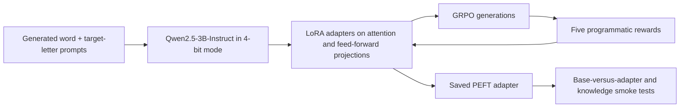

# LLM Post-Training with Verifiable Rewards

Teaching a 3-billion-parameter language model a precise, checkable skill with
reinforcement learning, on a single consumer-grade GPU.

| | |
| --- | --- |
| **Problem** | Language models often fail at simple procedural tasks such as counting letters, and full fine-tuning of a large model is expensive. |
| **Approach** | Efficient fine-tuning (LoRA on a 4-bit model) trained with GRPO, a reinforcement-learning method, using five automatic reward checks instead of human labels. |
| **Results** | Over a 200-step, 29-minute run on one T4 GPU, mean reward rose from 3.87 to 4.78 and final-answer reward from 0.71 to 0.95, while training only 0.96% of the model's parameters. |
| **Stack** | Python · PyTorch · Hugging Face TRL · PEFT (LoRA) · Unsloth · vLLM · Qwen2.5-3B-Instruct |

## Overview

An evidence-backed parameter-efficient post-training experiment that adapts
Qwen2.5-3B-Instruct to follow a structured letter-counting procedure. The
project combines 4-bit model loading, LoRA, Group Relative Policy Optimization
(GRPO), five deterministic reward functions, saved training traces, and a
reloadable PEFT adapter.

## Experiment at a glance

| Component | Implementation |
| --- | --- |
| Base model | `unsloth/qwen2.5-3b-instruct-unsloth-bnb-4bit` |
| Adaptation | LoRA rank 16, alpha 16, seven projection modules |
| Objective | Structured letter-by-letter counting with a final count |
| Training data | 401 generated word-and-letter prompts |
| Optimization | GRPO through Hugging Face TRL |
| Reward design | Numbering, spelling, running count, format, correctness |
| Compute | One NVIDIA Tesla T4, 200-step run in 29m12s |
| Deliverable | 59.9 MB safetensors LoRA adapter stored with Git LFS |

## Training workflow

The reward functions inspect different parts of the requested response rather
than relying on one opaque score:

1. sequential line numbering;
2. correct spelling of the input word;
3. correct running count after each character;
4. response-format compliance;
5. correctness of the final count.

## Saved training evidence

The values below are training-batch signals parsed from the retained notebook
output. They are not held-out accuracy or proof of generalization.

| Metric | First 20 steps | Last 20 steps |
| --- | ---: | ---: |
| Mean total reward | 3.86881 | 4.77946 |
| Mean final-answer reward | 0.7125 | 0.95 |

The longer run used a learning rate of `0.0001`, beta of `0.001`, four
generations per prompt, per-device batch size of four, and one gradient
accumulation step. The adapter contains 29,933,568 trainable parameters, or
0.96% of the 3,115,872,256 observed model parameters.

## Evaluation boundary

- The one-example Chain-of-Thought baseline followed the target structure but
  returned the wrong count for `engage`.
- The final comparison used one generated training item; both the base and
  adapted models answered correctly. It does not establish adapter superiority.
- A single capital-city question is only a knowledge-retention smoke test and
  does not establish the absence of catastrophic forgetting.
- There is no held-out split, accuracy estimate, multi-seed run, ablation, or
  statistical uncertainty analysis.
- Rewards are deterministic Python functions, not human-preference data or a
  learned reward model; this work is not RLHF.

These limits are intentional parts of the evidence record, not hidden gaps.
See [PROJECT_EVIDENCE.md](PROJECT_EVIDENCE.md) for the implementation-to-evidence
mapping and exact saved values.

## Repository contents

- `grpo_letter_counting.ipynb`: executed experiment notebook
  with prompts, reward checks, training logs, plots, and comparisons.
- `grpo_saved_lora/adapter_model.safetensors`: saved LoRA adapter in Git LFS.
- `grpo_saved_lora/adapter_config.json`: PEFT configuration.
- `grpo_saved_lora/README.md`: adapter model card with intended use and limits.
- `PROJECT_EVIDENCE.md`: artifact-backed evaluation and claim boundaries.
- `CHECKSUMS.sha256`: integrity hashes for the reviewed artifacts.

The executed notebook is retained as an experiment record, with revised explanatory text and unchanged
executable statements and saved outputs. It is not presented as a clean-room
implementation or a fully reproducible environment.

## Observed environment

The archived run reports Python 3.12, Unsloth 2025.9.7, Transformers 4.55.4,
vLLM 0.10.1, PEFT 0.17.1, and PyTorch 2.7.1 with CUDA 12.6 on one Tesla T4.
These are observed versions rather than a tested lockfile; reproducing the GPU
run requires a compatible CUDA environment and the source notebook setup.

## License

No new license is granted for the Qwen base model, Unsloth, third-party code,
or the saved adapter weights; their original terms continue to apply.
